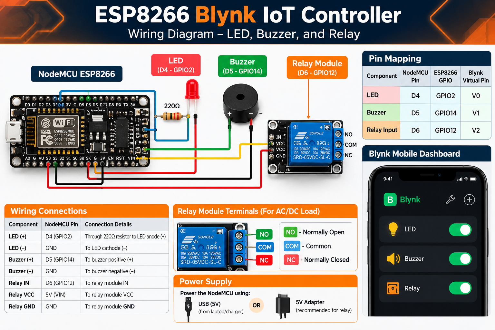

# ⚡ ESP8266 Blynk IoT Controller

  <strong>A Wi-Fi-enabled IoT project for remotely controlling
  multiple electronic devices using Blynk Cloud.</strong>

  
  
  
  

---

## 📌 Overview

The ESP8266 Blynk IoT Controller is a Wi-Fi-based
embedded systems project that allows users to control
electronic components remotely through the Blynk mobile
application and cloud platform.

The project integrates an ESP8266 NodeMCU board with an
LED, an active buzzer, and a relay module to demonstrate
IoT-based device control.

## 🎬 Project Demo

Watch the recorded demonstration of the project.

**[▶️ View / Download Demo Video](assets/videos/esp8266-blynk-demo.mp4)**

HEAD
> If the video does not play directly in your browser,
> use the file page to access it.
## 🔌 Circuit Diagram

The following diagram illustrates the ESP8266 NodeMCU connections
for the LED, active buzzer, and relay module, along with the
corresponding Blynk virtual pin configuration.

  

- NodeMCU ESP8266 development board
- LED and suitable current-limiting resistor
- Two-pin active buzzer (if using the tested active-buzzer setup)
- Compatible relay module
- Jumper wires and a suitable power source
 df36a46 (Add ESP8266 wiring diagram)

## ✨ Features

- 📱 Remote control through the Blynk application
- 📡 Wi-Fi connectivity using ESP8266
- 💡 LED control
- 🔊 Active buzzer control
- 🔌 Relay module control
- ☁️ Cloud-connected device interaction
- 🔧 Modular hardware and software design

## 🛠️ Hardware Components

| Component | Purpose |
|---|---|
| ESP8266 NodeMCU | Main microcontroller and Wi-Fi connectivity |
| LED | Visual output |
| Active buzzer | Audible output |
| 5V relay module | Switching demonstration |
| USB cable | Programming and power |
| Jumper wires | Circuit connections |

## 💻 Technology Stack

- **Microcontroller:** ESP8266 NodeMCU
- **Programming Language:** C++
- **Development Environment:** Arduino IDE
- **IoT Platform:** Blynk IoT
- **Communication:** Wi-Fi
- **Version Control:** Git and GitHub
- **Large File Storage:** Git LFS

## 🔌 Pin Configuration

| Component | ESP8266 Pin | GPIO | Blynk Virtual Pin |
|---|---|---|---|
| LED | D4 | GPIO2 | V0 |
| Active Buzzer | D5 | GPIO14 | V1 |
| Relay Module IN | D6 | GPIO12 | V2 |

> **Note:** Relay behavior depends on the module's trigger
> polarity. Verify the logic before operating the circuit.

## ⚙️ Getting Started

### 1. Install the required software

- Install Arduino IDE.
- Install ESP8266 board support.
- Install the Blynk library.
- Connect the NodeMCU to your computer.

### 2. Configure credentials

Create a local `secrets.h` file using the supplied
`secrets.example.h` template.

Add your own Wi-Fi credentials and Blynk device
credentials to the local configuration.

**Never commit real credentials, authentication tokens,
or passwords to GitHub.**

### 3. Configure Blynk

Create a device in Blynk Cloud and configure the required
virtual pins:

- V0 — LED
- V1 — Buzzer
- V2 — Relay

### 4. Upload the firmware

Open the Arduino sketch in the `src/` directory, select
the appropriate ESP8266 board and serial port, and upload
the firmware.

### 5. Test the device

Connect the hardware, open the Blynk application, and
test each configured control.

## 🔐 Security

- Keep `secrets.h` out of version control.
- Use placeholder values in `secrets.example.h`.
- Never publish Wi-Fi passwords or Blynk authentication tokens.
- Regenerate credentials if they are accidentally exposed.

## ⚠️ Safety

Test the project using low-voltage DC circuits first.

Do not connect mains electricity directly to the
ESP8266 or breadboard. Any mains-voltage application
requires properly rated equipment, isolation, and
qualified supervision.

## 📚 Learning Outcomes

This project demonstrates practical concepts in:

- Internet of Things (IoT)
- Embedded systems programming
- Wi-Fi-based communication
- Cloud-connected device control
- Microcontroller GPIO interfacing
- Hardware and software integration
- Git, GitHub, and Git LFS

## 👨‍💻 Author

**Jayadeep Paul**

GitHub: [@25A31A42J6](https://github.com/25A31A42J6)

---

  Built to explore IoT, embedded systems, and connected devices. ⚡

